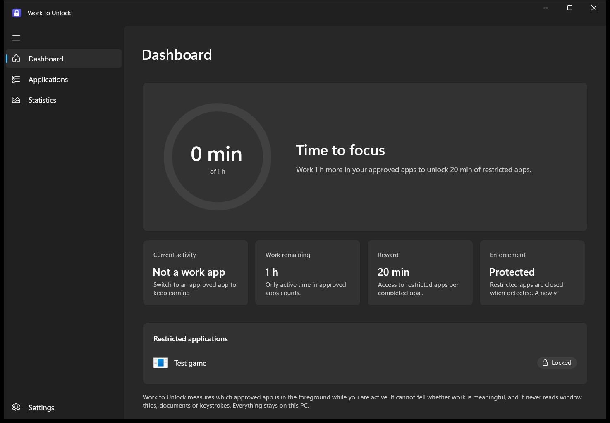

# Work to Unlock

Earn time in distracting apps by actively working in approved ones.

Work 60 minutes in Visual Studio Code or Blockbench, earn 20 minutes with Steam and Discord. When the reward runs out, Steam and Discord are locked again. Repeat.



## How it works

| Piece | What it does |
|---|---|
| **Agent** (`WorkToUnlock.Agent.exe`) | Per-user background process, started at sign-in, no admin rights. Samples the foreground app every 500 ms, detects idle time, lock/unlock, Remote Desktop disconnects and sleep, accumulates qualifying work, runs the reward state machine, persists everything to SQLite, enforces restrictions, and owns the tray icon. |
| **Dashboard** (`WorkToUnlock.App.exe`) | WinUI 3 window (Fluent, Mica, light/dark). A client of the agent over a per-user named pipe. Closing it never stops tracking or enforcement. |
| **Strict service** (`WorkToUnlock.Service.exe`, optional) | Elevated Windows service that can block restricted apps from *starting* using AppLocker rules it owns. Off unless an administrator enables it. |

Reward states: **Working** → (work target reached) → **Reward ready** → (you click *Unlock*) → **Unlocked** → (reward time elapsed) → back to **Working** with progress reset.

Only time that is genuinely in the foreground of an approved app, while you are active (default idle threshold 60 s), with the session unlocked and the PC awake, counts. Work to Unlock cannot tell whether the work is meaningful, and it never reads window titles, documents, keystrokes or screenshots.

## Install

1. Download `WorkToUnlock-<version>-x64.msi` from the release artifacts (or build it, see below).
2. Run it. The installer needs administrator approval once, because it installs to Program Files and registers the agent to start at sign-in for every user.
3. Leave **Strict enforcement service** unselected unless you run Windows Enterprise, Education or Server and want launch blocking (see [docs/enforcement.md](docs/enforcement.md)).
4. Tick **Open Work to Unlock** on the last page. On first start the agent adds Visual Studio Code and Blockbench as work apps and Steam and Discord as restricted apps if they are installed.

Requirements: Windows 10 version 2004 (build 19041) or later, or Windows 11, x64. No separate .NET or Windows App SDK runtime is needed; the build is self-contained.

A portable build (`WorkToUnlock-<version>-win-x64.zip`) is also produced. Unzip it anywhere and run `WorkToUnlock.App.exe`; the agent registers itself for the current user only.

**Uninstall** from *Settings > Apps*. Uninstalling closes the agent and dashboard, removes the startup entry, and removes any AppLocker rules the strict service created. Your local data in `%LOCALAPPDATA%\WorkToUnlock` is kept; delete that folder to remove it.

## Build from source

Requirements: .NET 10 SDK. The WinUI dashboard and the installer build on Windows only; everything else (including all unit tests) also builds on Linux.

```bash
dotnet build WorkToUnlock.sln
```

```bash
dotnet test tests/WorkToUnlock.Core.Tests
```

```bash
dotnet test tests/WorkToUnlock.Agent.Tests
```

```bash
dotnet test tests/WorkToUnlock.IntegrationTests
```

```bash
pwsh ./build/Publish.ps1 -Version 1.0.0
```

`Publish.ps1` writes a self-contained app folder to `artifacts/publish/win-x64`, a portable zip to `artifacts/`, and the MSI to `artifacts/installer/`. On Linux, use `WorkToUnlock.Portable.slnf`.

Keep the repository path short (under about 60 characters): the WinUI XAML compiler fails on paths longer than 260 characters even with long paths enabled.

## Repository layout

```text
src/
  WorkToUnlock.Core/            Domain: reward state machine, work tracker, rule matching, safety rules, IPC contracts
  WorkToUnlock.Infrastructure/  SQLite persistence and migrations, named pipes with ACLs, Win32 tracking interop, logging
  WorkToUnlock.Enforcement/     Process enforcement, application discovery, AppLocker policy management
  WorkToUnlock.Agent/           Background agent: hosting, tray, session/power notifications, IPC server
  WorkToUnlock.App/             WinUI 3 dashboard (MVVM, CommunityToolkit.Mvvm)
  WorkToUnlock.Service/         Optional elevated strict-enforcement service
tests/
  WorkToUnlock.Core.Tests/        Reward engine, tracker, matcher and validation (portable)
  WorkToUnlock.Agent.Tests/       Agent services, process enforcer, SQLite, AppLocker merging (portable)
  WorkToUnlock.IntegrationTests/  Native Windows tests and an end-to-end agent test
  WorkToUnlock.TestTarget/        Harmless stand-in "restricted app" used by the integration tests
installer/WorkToUnlock.Installer/ WiX v6 MSI
build/Publish.ps1                 Publish + package
tools/                            Icon generator, agent request helper, window capture
docs/                             Architecture, enforcement, testing, recovery, implementation plan
```

## Documentation

- [Architecture](docs/architecture.md)
- [Enforcement](docs/enforcement.md): what is and is not guaranteed
- [Testing](docs/testing.md): automated coverage and the manual Windows test checklist
- [Recovery](docs/recovery.md): crashes, data corruption, AppLocker rollback, uninstall
- [Implementation plan and status](docs/implementation-plan.md)

## Privacy

Everything stays on your PC. The agent stores, per approved app, when qualifying work started and ended and how many milliseconds counted, plus reward history and an activity log of setting changes. It does not store window titles, document names, URLs, keystrokes or screenshots, and it makes no network connections. *Settings > Export local data* writes everything it has to a JSON file.

## Known limitations

- Process enforcement is best effort: a restricted app can run for up to about one second before it is closed, and the agent can be ended by the user from Task Manager. Strict mode (AppLocker) closes that gap on supported editions only.
- Strict mode is unavailable on Windows Home and Pro, which do not enforce local AppLocker policies.
- A restricted app started with administrator rights cannot be closed by the agent; the dashboard reports this as *Partly protected*.
- Notifications are tray balloon notifications from the agent; they respect Focus Assist / Do Not Disturb.

See [docs/implementation-plan.md](docs/implementation-plan.md) for what was verified on real Windows and what still needs manual testing.
